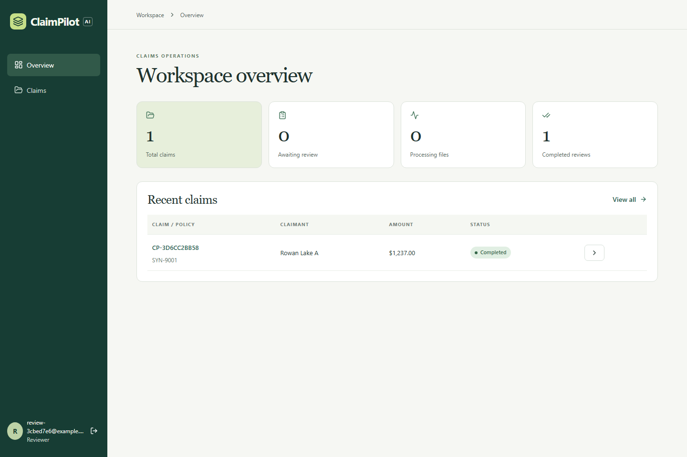
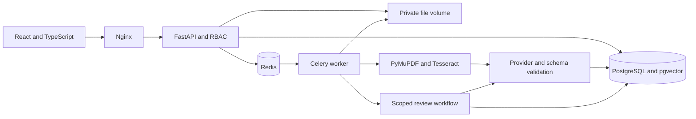

# ClaimPilot AI

ClaimPilot helps an insurance handler assemble a claim file and gives an assigned reviewer the source page behind each extracted field. A reviewer can correct a value, reject a recommendation, add a comment and complete the review. Completing a review records a human action. There is no payout decision endpoint.



## Run locally with Docker

Requires Docker Engine with Compose v2. From the repository root run:

```sh
docker compose up --build
```

Open [the workspace](http://localhost:8080) and select **Create an account**. The [interactive API reference](http://localhost:8080/docs) accepts the bearer token returned by JSON login. The [OpenAPI schema](http://localhost:8080/openapi.json) describes request formats.

The default provider runs offline. The first launch creates a database password, a signing key, named volumes for private originals and a PostgreSQL database with pgvector. Nginx binds to loopback. The API, database, Redis and worker communicate inside the Compose network. Production hosting, TLS, retention and backups require deployment-specific configuration.

### Walk through a claim

1. Register a handler. Create a claim with the values in one of the scenario folders below.
2. Upload the PDFs in that folder. Wait for their status to become **Ready**, then choose **Analyze claim**.
3. Open **Review report** to inspect discrepancies, the materials checklist and cited policy passages. Select a filename in **Extracted data** to see the original page alongside its quote.
4. To exercise role separation, register a second account, then assign its reviewer role from the operator shell:
   
   ```sh
   docker compose exec backend python -m app.manage reviewer reviewer@example.invalid
   ```

5. In the handler account, enter that email under **Review assignment**. Sign in as the reviewer, save a correction and complete the review. **Activity** shows the resulting audit events.

The same operator command supports `admin` and `handler`. An administrator can update account roles and the police report requirement under **Users**. A handler can see their own claims. A reviewer can access assigned claims. Uploaded files, page previews, policy search, reports and audit routes apply the same object-level access checks.

| Scenario | Files | Expected observation |
|---|---|---|
| Complete file | [01-complete](demo/01-complete) | All required materials present, source-backed policy passage |
| Conflicting dates | [02-date-mismatch](demo/02-date-mismatch) | Claim form and police report disagree by one day |
| Missing damage evidence | [03-missing-evidence](demo/03-missing-evidence) | Request for additional damage evidence |

[Watch the recorded browser workflow](demo/media/review-workflow.webm) · [Inspect the discrepancy report](demo/media/date-mismatch.png)

## Architecture



- **Documents.** Up to 20 MiB per upload and 50 pages per PDF. The service checks filename, media type and decoded content. It extracts text page by page and invokes OCR on image-only pages. Files are stored under generated IDs. Both extraction and original page previews preserve page numbering.
- **Facts.** Each field retains its original value, filename, page number and verbatim supporting text. A source check discards values and quotes absent from the page. This check establishes textual provenance. Semantic interpretation still needs human verification.
- **Verification.** Python compares dates, amounts, policy numbers, currencies and names, detects duplicate files by digest, and checks configured supporting materials. In OpenAI mode the provider also examines incident descriptions for semantic conflicts.
- **Policy search.** Policies are indexed as overlapping, page-preserving chunks. PostgreSQL ranks chunks by cosine distance within the authorized claim. The provider selects an exact excerpt from the top five passages or returns insufficient evidence.
- **Workflow.** Six allowlisted tools run in a fixed order. The service binds the claim and database session, validates typed tool outputs and saves a versioned report. Model calls accept no user IDs, paths or SQL. Source documents are untrusted model input. Failed document jobs support retry. Analysis can be rerun before completion. Previous analyses and audit events persist.
- **Human review.** Extracted facts retain original values alongside corrections. The stored analysis describes the evidence at analysis time. The extracted-data view and audit trail record subsequent reviewer actions.

### Providers

| Configuration | Extraction and retrieval |
|---|---|
| `AI_PROVIDER=local` (default) | Labelled English fields, heading classification and deterministic hashed word vectors for offline fixtures |
| `AI_PROVIDER=openai` | OpenAI structured responses, constrained function calls, semantic conflict detection and 256-dimensional embeddings |

To enable the external provider, copy `.env.example` to `.env`, set `AI_PROVIDER=openai`, supply `OPENAI_API_KEY` locally, and restart Compose. Set `OPENAI_MODEL` to a model available to your account that supports structured responses, function calls and temperature 0. The default is `gpt-4o-mini`. The embeddings provider uses `text-embedding-3-small`. Provider selection applies to both the API and worker. Start a fresh demo dataset when switching providers so stored and query vectors use the same embedding space. OpenAI mode transmits document text for inference. Responses requests set `store=False`. Use fictional data in the portfolio demo. [OpenAI structured outputs](https://developers.openai.com/api/docs/guides/structured-outputs)

### Development without containers

Use Python 3.11+, Node 22+ and Tesseract on PATH for image and scanned-page OCR. In a virtual environment install dependencies and run the API from the repository root:

```sh
python -m pip install -r requirements.txt
python -m uvicorn app.main:app --port 8000
```

In a second terminal:

```sh
cd frontend
npm ci
npm run dev
```

Open [the development workspace](http://localhost:5173). Without infrastructure environment variables, the API uses SQLite under `state/` and a background thread pool. To provision a local reviewer run `python -m app.manage reviewer reviewer@example.invalid` against the same state directory.

## Quality and reproducibility

```sh
python -m pytest -q
ruff check app tests
python -m app.ai.evaluation.run
cd frontend
npm ci
npm test
npm run build
```

The [evaluation dataset](evaluation/cases.jsonl) contains 50 fictional vehicle claims with annotated document pages, expected fields, policy citations, discrepancies and missing materials. The runner renders PDFs, processes them with the selected provider in isolated storage and compares the results with ground truth. It saves a [metric report](evaluation/REPORT.md) and [case-level results](evaluation/results.json). `EVAL_OUTPUT_DIR` selects a separate experiment directory. `python -m app.ai.evaluation.fixtures` regenerates the corpus and demonstration PDFs.

The committed measurements use the offline provider, five document classes and labelled English text. The corpus includes 10 cases with insufficient policy evidence and six or more policy passages per case. Production document variability, OCR accuracy and live LLM quality require a separate sample. A local fixture score should not be interpreted as an OpenAI benchmark.

The Compose smoke test recognized the incident date on both a scanned PDF and a PNG using Tesseract. A local run measured **81.9 ms p95** for 200 authenticated reads across five concurrent users. Registration and AI jobs are outside that latency measurement. Run `python tests/stack_smoke.py` against the running demo stack to repeat it.

For browser testing, start the stack, provision a reviewer, set `E2E_URL`, `E2E_REVIEWER_EMAIL` and `E2E_REVIEWER_PASSWORD`, then run `npx playwright install chromium` and `npm run e2e` in `frontend/`. Playwright registers a handler, uploads real PDFs, checks the date conflict, opens its source, switches to the assigned reviewer, corrects the field and completes the review. GitHub Actions runs lint, unit tests, evaluation, the frontend build and the browser workflow on the Compose stack.
